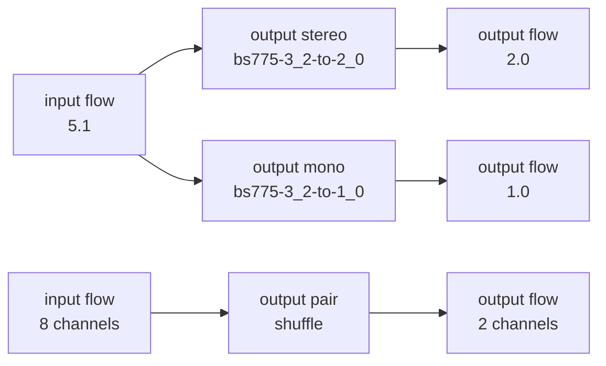

# foldz

Headless broadcast audio downmix and channel matrix over MXL, built on the
[samplez](https://github.com/danielclasen/samplez) engine, written in Rust.

foldz reads 48 kHz audio flows from MXL domains and writes each configured
output to its own MXL flow, at the sample index it read, on libmxl's TAI
timeline. Every output applies one gain matrix to one input: a downmix
preset transcribed from a published standard, a routing of channels by
label or index, or an explicit matrix. It is configured by one JSON file
read at start-up; its HTTP API is read-only and reports the matrices in use
and the engine's state. With NMOS enabled, its inputs and outputs are NMOS
receivers and senders that IS-05 connects over MXL.

- Downmix presets from ITU-R BS.775-4, ATSC A/52:2018 and ETSI TS 103 190-1,
  each reporting its citation
- `select` and `shuffle` routings, explicit gain matrices, per-output gain
  and optional LFE inclusion
- Several inputs, outputs and MXL domains in one process
- NMOS IS-04 v1.3 registration and IS-05 v1.2 connections over MXL per
  AMWA BCP-007-03, checked in CI by the AMWA nmos-testing suites
- A real-time audio thread (`SCHED_FIFO`, locked memory) that runs degraded
  and says so when the privileges are missing
- HTTPS with certificate files or a generated certificate, bearer token or
  authenticating-proxy auth
- `/healthz`, `/readyz` and Prometheus `/metrics`
- A container image, a release binary and a Helm chart



Not in this version: replicated outputs (more than one entry in an
output's `flows` is refused).

## Quick start

foldz needs an MXL domain, a directory on tmpfs shared with the processes
that write and read its flows. This builds the image from this
repository and folds a 5.1 flow to stereo with it, as the calling user,
with the API and ops listeners on localhost. Releases publish the same
image as `ghcr.io/danielclasen/foldz:<version>`, starting with the first
release.

```sh
docker build -t foldz:local .
mkdir -p /dev/shm/mxl/studio
cat > config.json <<'JSON'
{
  "listeners": { "api": { "bind": "0.0.0.0", "port": 8080 } },
  "domains": [{ "name": "studio", "path": "/mxl/studio" }],
  "inputs": [{
    "name": "programme",
    "channels": 6,
    "layout": ["L", "R", "C", "LFE", "Ls", "Rs"],
    "flow": "5fbec3b1-1b0f-417d-9059-8b94a47197ed"
  }],
  "outputs": [{
    "name": "stereo",
    "flows": ["6fbec3b1-1b0f-417d-9059-8b94a47197ed"],
    "layout": ["L", "R"],
    "preset": "bs775-3_2-to-2_0"
  }]
}
JSON
docker run --rm --name foldz --user "$(id -u):$(id -g)" --read-only --tmpfs /tmp \
  -v /dev/shm/mxl/studio:/mxl/studio \
  -v "$PWD/config.json:/etc/foldz/config.json:ro" \
  -p 127.0.0.1:8080:8080 -p 127.0.0.1:9090:9090 \
  foldz:local
```

In another shell:

```sh
curl -s http://127.0.0.1:9090/readyz
curl -s http://127.0.0.1:8080/api/v1/downmix
curl -s http://127.0.0.1:8080/api/v1/status
ls /dev/shm/mxl/studio
```

`/api/v1/downmix` shows the gain matrix of `stereo` and the table it comes
from. The output flow `6fbec3b1-...` is created at start whether or not a
producer writes the input flow yet; until one does, `/api/v1/status` reports
the input's error and the output carries silence. Ctrl-C stops foldz and
deletes the output flow.

The container runs without real-time privileges here and reports that in
`/api/v1/status` (`rt`); [Real-time setup](#real-time-setup) has what they
need. With `auth.mode` `none` the API answers only requests whose `Host` is
`localhost`, `127.0.0.1` or listed in `api.allowedHosts`.

## Presets

Channel labels are the IS-04 v1.3 `source_audio.json` channel symbols
(`L`, `R`, `C`, `LFE`, `Ls`, `Rs`, `Lss`, `Rss`, `Lrs`, `Rrs`, `Lc`, `Rc`,
`Cs`, `HI`, `VIN`, `M1`, `M2`, `Lt`, `Rt`, `Lst`, `Rst`, `S`, `NSC000` to
`NSC128`, `U01` to `U64`), plus `-` for an unused channel. A layout has 1
to 64 channels and no label twice except `-`.

A preset reads its input channels by label, wherever they sit in the input
layout, and the output layout must be exactly the channels it produces.
Coefficients are transcribed from the cited tables and applied without
headroom scaling; `gainDb` per output scales the whole matrix.

| Preset | Reads | Output layout | Source |
|---|---|---|---|
| `bs775-3_2-to-1_0` | `L R C Ls Rs` | `C` | ITU-R BS.775-4 (12/2022), Annex 4, Table 2 |
| `bs775-3_2-to-2_0` | `L R C Ls Rs` | `L R` | ITU-R BS.775-4 (12/2022), Annex 4, Table 2 |
| `bs775-3_2-to-3_0` | `L R C Ls Rs` | `L R C` | ITU-R BS.775-4 (12/2022), Annex 4, Table 2 |
| `bs775-3_2-to-2_1` | `L R C Ls Rs` | `L R S` | ITU-R BS.775-4 (12/2022), Annex 4, Table 2 |
| `bs775-3_2-to-3_1` | `L R C Ls Rs` | `L R C S` | ITU-R BS.775-4 (12/2022), Annex 4, Table 2 |
| `bs775-3_2-to-2_2` | `L R C Ls Rs` | `L R Ls Rs` | ITU-R BS.775-4 (12/2022), Annex 4, Table 2 |
| `a52-loro-clev<c>-slev<s>`, `c` one of `0.707`, `0.595`, `0.500`, `s` one of `0.707`, `0.500`, `0` | `L R C Ls Rs`, `L R C` with `slev0` | `L R` | ATSC A/52:2018, clause 7.8.2, Tables 5.9 and 5.10 |
| `a52-ltrt` | `L R C Ls Rs` | `Lt Rt` | ATSC A/52:2018, clause 7.8.2 |
| `ac4-7_1-to-5_1` | `L R C LFE Lss Rss Lrs Rrs` | `L R C LFE Ls Rs` | ETSI TS 103 190-1 V1.4.1, clause 6.2.17.5, Table 219, row 3/4/0.x; AC-4 side surrounds read `Lss`/`Rss` and back surrounds `Lrs`/`Rrs` |
| `ac4-bs775-7_1-to-2_0` | `L R C Lss Rss Lrs Rrs` | `L R` | `ac4-7_1-to-5_1` followed by `bs775-3_2-to-2_0`, the product of the two matrices |

`select` copies input channels by label, `shuffle` by 0-based index from
`source`, and `matrix` takes an explicit gain matrix with one row per output
channel.

A preset without an `LFE` output leaves the input's LFE out (`lfe:
"drop"`, the default). `lfe: {"include": {"gainDb": <dB>}}` adds it to
every output channel of a 1/0 or 2/0 preset at that gain; the output's
`gainDb` then scales it like every other gain, so LFE arrives at the sum
of the two. `lfe` is refused on `ac4-7_1-to-5_1`, `select`, `shuffle` and
`matrix`.

## Configuration

One JSON file, `foldz --config <file>`. Unknown fields are refused.

| Key | Default | |
|---|---|---|
| `mxl.libraryPath` | `/opt/mxl/lib/libmxl.so` | libmxl, loaded at start |
| `engine.sampleRate` | `48000` | the only rate accepted |
| `engine.blockSize` | `48` | samples per block, 16 to 1024 |
| `engine.readerMarginSamples` | `576` | read delay behind libmxl's clock |
| `engine.maxCatchupBlocks` | `2` | overdue blocks processed in order after a late wake; beyond that only the newest block is processed |
| `engine.pruneAfterBlocks` | `50` | blocks of a frozen producer head before the input is pruned; raised to twice the producer's `maxCommitBatchSizeHint` plus `readerMarginSamples` when that is longer |
| `engine.rampSamples` | `480` | length of every gain ramp and input fade |
| `rt.enabled` | `true` | `false` skips capabilities, memory locking and `SCHED_FIFO` |
| `rt.priority` | `70` | `SCHED_FIFO` priority, 1 to 99 |
| `rt.rtCpu` | `auto` | `auto`, `none`, `first`, `last` or an index into the allowed CPUs |
| `listeners.api` | `127.0.0.1:8080` | `{bind, port, tls}`: `/api/v1` |
| `listeners.ops` | `0.0.0.0:9090` | `{bind, port, tls}`: `/healthz`, `/readyz`, `/metrics` |
| `listeners.nmos` | `127.0.0.1:8081` | `{bind, port, tls}`: `/x-nmos/` with NMOS enabled, bound either way; TLS refused with NMOS enabled |
| `listeners.machine` | | refused |
| `listeners.*.tls` | `{mode: none}` | `mode` `none`, `files` (`certFile`, `keyFile`, `clientCaFile`) or `selfSigned` (`sans`) |
| `auth.mode` | `none` | `none`, `token` or `proxy` |
| `auth.token.file` | | the bearer token, `token` mode |
| `auth.proxy` | | `userHeader`, `groupsHeader`, `groupRoles`, `proxy` mode |
| `auth.machineToken` | | refused |
| `api.allowedHosts` | `[]` | `Host` names accepted besides `localhost` and `127.0.0.1` |
| `api.allowedOrigins` | `[]` | WebSocket `Origin`s; foldz serves no WebSocket |
| `nmos.enabled` | `false` | registers the inputs and outputs and takes IS-05 connections, see [NMOS](#nmos) |
| `nmos.seed`, `nmos.seedName` | | a UUID or a name the resource ids derive from, one of them required with NMOS enabled; the same one gives the same ids after a restart |
| `nmos.advertiseHost` | | host or address controllers reach the NMOS listener at; required with NMOS enabled |
| `nmos.advertisePort` | `0` | `0` advertises `listeners.nmos.port` |
| `nmos.registry.url` | | a Registration API, `http://host[:port]` with NMOS enabled; set, no DNS-SD browsing |
| `nmos.registry.dnsSdDomain` | | the unicast DNS-SD domain browsed; empty browses the resolver's search domains, then multicast DNS-SD |
| `nmos.heartbeatS` | `5` | seconds between heartbeats, also each registry request's timeout; 1 to 60 |
| `nmos.asset.manufacturer` | `danielclasen` | the BCP-002-02 manufacturer tag |
| `domains[]` | | `name`, `path` (absolute, normalised, unique), `id` (the domain's MXL UUID, for NMOS); at least one |
| `inputs[]` | | `name`, `channels`, `layout` (one label per channel), `domain` (required with several domains), `flow` (UUID; absent or `null` starts the input unconnected); at least one |
| `outputs[]` | | see below; at least one |

An output:

| Key | |
|---|---|
| `name` | unique among inputs and outputs |
| `input` | the input read; required with several inputs |
| `domain` | required with several domains |
| `flows` | `[<UUID>]`, the flow written |
| `mergedFlow` | refused with one entry in `flows` |
| `label` | the flow's label; the output's name when empty |
| `group`, `role` | the flow's `urn:x-nmos:tag:grouphint/v1.0` tag `<group>:<role>`; default the output's name and `Audio`; no `:`. With NMOS the Sender's grouphint takes `group` with the role `Audio out`, and no two outputs share a group |
| `layout` | one label per output channel |
| `preset` | a preset name, `select` or `shuffle`; or `matrix` instead |
| `source` | with `shuffle`: per output channel the 0-based input channel |
| `matrix` | rows per output channel, columns per input channel |
| `lfe` | `"drop"` or `{"include": {"gainDb": <dB>}}` |
| `gainDb` | default `0` |

An output reading an unconnected input is written silent. Flow ids are
lowercase UUIDs; the nil UUID is reserved. With NMOS enabled, flow and
domain ids are MXL UUIDs: a version digit of 1 to f and the variant 8 to
b. An id names a flow within its domain: no flow is read by
two inputs or both read and written in one domain, while the same id read
in another domain is another flow. Every written id is unique across all
domains, as the samplez engine requires of its outputs.

## API

| Listener | Path | |
|---|---|---|
| api | `GET /api/v1/downmix` | every input and output with the gain matrix applied, `gainDb` included, and the preset's citation |
| api | `GET /api/v1/status` | RT setup steps, input and output state and the flow each input reads, engine counters, TLS certificates in use, each NMOS port's connection and last activation; 503 once the engine has stopped |
| api | `POST /api/v1/login` | `token` mode: the token for a session cookie |
| ops | `GET /healthz` | 200 while the audio thread processed a block within the last second |
| ops | `GET /readyz` | 200 while the engine runs and the API listener serves |
| ops | `GET /metrics` | Prometheus text: the engine counters of `/api/v1/status` (`samplez_rt_heartbeat_blocks_total`, `samplez_deadline_miss_total`, `samplez_overrun_skipped_samples_total` and others), the maxima `samplez_wake_jitter_max_nanoseconds` and `samplez_process_time_max_nanoseconds` (counters, since start), per input once connected `samplez_input_reads_total{input, outcome}` and `samplez_input_validity_probes_total{input}`, and with NMOS `samplez_nmos_apply_failures_total{port}` and `samplez_nmos_activation_late_seconds{port}` |
| nmos | `/x-nmos/node/v1.3/`, `/x-nmos/connection/v1.2/` | with NMOS enabled: the IS-04 Node API and the IS-05 Connection API |

`openapi.json` is the OpenAPI 3.1 document of `/api/v1` in `token` mode;
a test fails when it differs from the code.

## NMOS

With `nmos.enabled`, foldz is one IS-04 v1.3 Node with one Device
(BCP-002-02 function `Downmix`). Each output is a Source, Flow and Sender
and each input a Receiver, all with transport `urn:x-nmos:transport:mxl`
(AMWA BCP-007-03), grouped by BCP-002-01 grouphints: a Sender's is the
output's `group` with the role `Audio out`, so it names the same group as
the MXL flow's grouphint, whose role is the output's `role`; a Receiver's
is `<input name>:Audio in`. Each output then needs a group of its own.
Flows are `audio/float32` at 48 kHz. A Receiver's BCP-004-01 caps take
exactly the input's channel count. The ids are UUIDv5 of the seed and the
input's or output's name.

foldz finds a registry at `nmos.registry.url`, else by unicast DNS-SD, else
by multicast DNS-SD, heartbeats it, and deletes its Node from it on SIGTERM
before its flows go, waiting at most 5 s for the registry's answer.
With no registry found it is not registered, and it does not advertise
itself peer to peer.

Each domain's MXL id is the `id` of its `domain_def.json` when the domain
has one, else `domains[].id`; both present and different, or neither, stop
foldz at start. A port's `mxl_domain_id` takes only its own domain.

IS-05 v1.2, `/single` and `/bulk`:

- A receiver's `mxl_flow_id` is any MXL UUID but a flow one of foldz's
  outputs writes in that domain; a flow present in the domain must match
  the caps, an absent one is accepted and read once it appears.
  `master_enable: true` routes the input to the flow with the engine's fade;
  `false` detaches it, and its outputs read silence.
- A sender's `mxl_flow_id` is the configured flow only. `master_enable:
  false` releases the writer, which deletes the flow; `true` creates it
  again. A flow another writer holds is a failed activation.
- A scheduled activation switches at its time's sample index rounded up to
  a block, at most `engine.blockSize - 1` samples late. foldz applies it the
  engine's buildLead plus 10 ms early, so the engine can stamp that index.
  Each input route or detach takes one generation and the engine builds
  one at a time, so receivers activated together switch one buildLead
  apart.
- An activation the engine refuses, or an output whose flow is not created
  within 5 s, turns the port's `master_enable` false in `/active`, counts in
  `samplez_nmos_apply_failures_total` and shows in `/api/v1/status`; the
  input is detached from the activation's index, or the output disabled.
  A route the engine stamps later than asked is logged with the sample it
  switches at.

Not covered:

- IS-05 state is held in memory: a restart starts from the config, and
  scheduled activations still pending are lost.
- A scheduled receiver activation cancelled within buildLead of its time
  is already stamped: the cancelled flow plays from that time for up to a
  buildLead before the route back lands.
- Scheduled activations wait on the monotonic clock from the time they are
  received: a TAI clock step in between moves them by the step.
- The NMOS listener has no authentication and no TLS (IS-10 and
  BCP-003-01 are out of scope), and IS-05 on it re-routes inputs and stops
  outputs. Its bind address and a NetworkPolicy are what protect it. foldz
  warns at start when it is bound to a loopback address and advertised as
  another host.

CI runs the AMWA [nmos-testing](https://github.com/AMWA-TV/nmos-testing)
suites IS-04-01 (unicast and multicast DNS-SD), IS-05-01 and BCP-007-03-01
against the image (`tests/nmos/conformance.sh`), each against a fresh
container, and `tests/nmos/gate.py` fails on any Fail, Warning or Not
Implemented and on any other result not listed with its reason in
`tests/nmos/expected.json`. The listed ones:

| Suite | Tests | Result | Why |
|---|---|---|---|
| IS-04-01 | `test_01`, `test_01_01` (unicast run), `test_02`, `test_02_01` (multicast run), `test_12` | Test Disabled | the other DNS-SD mode; disabled for Nodes from v1.3 |
| IS-04-01 | `test_13`, `test_14` | Could Not Test | the tool exercises RTP receivers only |
| IS-04-01 | `test_19`, `test_19_01` | Could Not Test | MXL ports have no interface bindings, so the Node lists no interfaces |
| IS-04-01 | `test_22` | Manual | `conformance.sh` compares every resource id across the restarts |
| IS-05-01 | `test_01` to `test_08`, `test_33` | Not Applicable | replaced by the `auto` tests |
| IS-05-01 | `test_09_01`, `test_11`, `test_11_02`, `test_12`, `test_12_02`, `test_15`, `test_16`, `test_41`, `test_42` | Could Not Test | MXL senders and receivers are covered by BCP-007-03-01 |
| BCP-007-03-01 | `test_15` | Manual | `tests/e2e.rs` releases and recreates a sender's flow |
| all | `auto_node_17` to `_23`, `auto_connection_23` to `_29` | Test Disabled | authorization checks, IS-10 is out of scope |

## Running it standalone

foldz runs on Linux x86_64 with glibc 2.34 or later and `libgcc_s.so.1`.
Each release carries the binary as `foldz-<version>-x86_64-linux`, the
licences of the Rust crates in it as `foldz-<version>-THIRD-PARTY.txt` and
the SHA-256 sums of both as `foldz-<version>-SHA256SUMS`, built in the same
stage as the image's binary:

```sh
gh release download v<version> --repo danielclasen/foldz --pattern 'foldz-*'
sha256sum -c foldz-<version>-SHA256SUMS
install -m 0755 foldz-<version>-x86_64-linux ./foldz
./foldz --version
```

It loads libmxl v1.1.0 (`dmf-mxl/mxl`, Release build) from
`mxl.libraryPath` at start, a C++ library that needs `libstdc++.so.6` as
well. The image carries that build at `/opt/mxl/lib`, and the binary at
`/usr/local/bin/foldz`:

```sh
id=$(docker create ghcr.io/danielclasen/foldz:<version>)
docker cp -L "$id:/opt/mxl/lib/libmxl.so" ./libmxl.so
docker cp "$id:/opt/mxl/share/licenses" ./mxl-licenses
docker cp "$id:/usr/local/bin/foldz" ./foldz
docker rm "$id"
```

foldz needs write access to the MXL domain directory.

SIGINT or SIGTERM stops foldz; it deletes its output flows on the way out
and exits with status 0. A usage or config error, a token or TLS file that
cannot be read included, exits with status 2 before anything starts. A
listener that cannot bind stops the start before any flow is created and
exits with status 1, as does an engine that fails to start or a listener
that fails while serving.

### HTTPS

Each listener serves plain HTTP unless its `tls.mode` says otherwise.

A generated certificate, for a host without one:

```json
"listeners": {
  "api": { "bind": "0.0.0.0", "port": 8443,
           "tls": { "mode": "selfSigned", "sans": ["foldz.example", "192.0.2.10"] } }
}
```

It is generated at each start and kept in memory only, valid for a year
from an hour before it is generated and replaced at the first reload
within 30 days of its expiry. foldz logs its SHA-256 fingerprint at start
(`foldz: api listener TLS selfSigned: certificate SHA-256 ...`) and
reports it in `/api/v1/status`; compare it with what a client sees:

```sh
openssl s_client -connect foldz.example:8443 </dev/null 2>/dev/null \
  | openssl x509 -noout -fingerprint -sha256
```

A certificate from files:

```json
"tls": { "mode": "files", "certFile": "/etc/foldz/tls/cert.pem",
         "keyFile": "/etc/foldz/tls/key.pem" }
```

`certFile` is PEM, the server certificate first, then its chain; `keyFile`
is PEM in PKCS#8, PKCS#1 or SEC1. Both are re-read every 10 s and a
changed pair applies from the next handshake; a pair that fails to load
keeps the previous one and counts in
`samplez_secret_reload_failures_total`. With `clientCaFile` (PEM) set, a
client must present a certificate issued by one of those CAs.

### Authentication

`auth.mode` is `none`, `token` or `proxy`. In every mode, a request
without a valid bearer must carry a `Host` of `localhost`, `127.0.0.1` or
a name in `api.allowedHosts`.

With `token`, every API request needs the bearer token from
`auth.token.file`, read without trailing whitespace and re-read every
10 s:

```sh
umask 077; openssl rand -hex 32 > /etc/foldz/token
curl --cacert cert.pem -H "Authorization: Bearer $(cat /etc/foldz/token)" \
  https://foldz.example:8443/api/v1/downmix
```

foldz reads the token, certificate and key files as the uid it runs as;
a file that uid cannot read stops the start with exit status 2. The
`umask 077` file above is readable by its owner only, so it suits a
container started with `--user "$(id -u):$(id -g)"` by the same user.

For browsers, `POST /api/v1/login` with the JSON body `{"token": "..."}`
and the header `X-Samplez-Request: 1` exchanges the token for a session
cookie valid for 12 hours.

In `proxy` mode the API listener must bind `127.0.0.1`, and foldz takes
the user and groups from the headers of an authenticating proxy in front
(`auth.proxy.userHeader`, default `X-Forwarded-User`;
`auth.proxy.groupsHeader`, default `X-Forwarded-Groups`, comma-separated);
`auth.proxy.groupRoles` maps group names to `viewer` or `operator` and
is required.

The ops listener (`/healthz`, `/readyz`, `/metrics`) is not authenticated.

### A complete example

`/etc/foldz/config.json`, a 5.1 flow folded to stereo with BS.775-4, over
HTTPS with a bearer token:

```json
{
  "mxl": { "libraryPath": "/opt/mxl/lib/libmxl.so" },
  "listeners": {
    "api": { "bind": "0.0.0.0", "port": 8443,
             "tls": { "mode": "files", "certFile": "/etc/foldz/tls/cert.pem",
                      "keyFile": "/etc/foldz/tls/key.pem" } },
    "ops": { "bind": "127.0.0.1", "port": 9090 }
  },
  "auth": { "mode": "token", "token": { "file": "/etc/foldz/token" } },
  "api": { "allowedHosts": ["foldz.example"] },
  "domains": [{ "name": "studio", "path": "/dev/shm/mxl/studio" }],
  "inputs": [{
    "name": "programme",
    "channels": 6,
    "layout": ["L", "R", "C", "LFE", "Ls", "Rs"],
    "flow": "5fbec3b1-1b0f-417d-9059-8b94a47197ed"
  }],
  "outputs": [{
    "name": "stereo",
    "flows": ["6fbec3b1-1b0f-417d-9059-8b94a47197ed"],
    "label": "Programme stereo",
    "layout": ["L", "R"],
    "preset": "bs775-3_2-to-2_0"
  }]
}
```

```sh
foldz --config /etc/foldz/config.json
```

or with the image, as the uid that owns the domain:

```sh
docker run --rm --user "$(id -u):$(id -g)" --read-only --tmpfs /tmp \
  --cap-add SYS_NICE --cap-add IPC_LOCK \
  -v /dev/shm/mxl/studio:/dev/shm/mxl/studio \
  -v /etc/foldz:/etc/foldz:ro -p 8443:8443 \
  ghcr.io/danielclasen/foldz:<version>
```

### Real-time setup

foldz runs its audio thread `SCHED_FIFO` (`rt.priority`, default 70) and
locks its memory with `mlockall(MCL_CURRENT | MCL_FUTURE)`. Either needs a
privilege: `CAP_SYS_NICE` or an `RLIMIT_RTPRIO` at least the priority, and
`CAP_IPC_LOCK` or an unlimited `RLIMIT_MEMLOCK`. Without it foldz runs
degraded and says so at start and in `/api/v1/status` (`rt`). The image's
binary carries the file capabilities `cap_sys_nice,cap_ipc_lock=p`: they
take effect when the container is granted both capabilities (with no
`no-new-privileges`), and change nothing otherwise. For a binary outside
the image, either set the same capabilities or raise the limits:

```sh
sudo setcap cap_sys_nice,cap_ipc_lock=p ./foldz
# or
ulimit -r 99 -l unlimited
```

Swap off and `vm.compact_unevictable_allowed=0` are deployment
requirements of the samplez engine; with the latter at 1, memory
compaction moves locked pages, which costs the audio thread page faults.

## Running it on Kubernetes

The Helm chart in [`charts/foldz`](charts/foldz/README.md) runs the image
with the config rendered from its values; each release publishes it as
`oci://ghcr.io/danielclasen/foldz/charts/foldz` with the release's version.

## Building

CI builds and tests inside the samplez builder image, pinned by digest in
`.github/workflows/ci.yml`:

```sh
docker run --rm --user "$(id -u):$(id -g)" -v "$PWD:/w" \
  -v "$PWD/.cargo-registry:/usr/local/cargo/registry" \
  -v "$PWD/.cargo-git:/usr/local/cargo/git" -w /w \
  ghcr.io/danielclasen/samplez-builder@sha256:92ece4452be98fff177b49fb201c8c693130c08845c42725dd5b1173d4863fba \
  cargo test --workspace --locked
```

The end-to-end test runs the binary against libmxl flows. `cargo test`
leaves it out; it runs on its own, with the RT limits raised:

```sh
docker run --rm --user "$(id -u):$(id -g)" --ulimit rtprio=99 --ulimit memlock=-1 \
  -e SAMPLEZ_REQUIRE_RT=1 -v "$PWD:/w" \
  -v "$PWD/.cargo-registry:/usr/local/cargo/registry" \
  -v "$PWD/.cargo-git:/usr/local/cargo/git" -w /w \
  ghcr.io/danielclasen/samplez-builder@sha256:92ece4452be98fff177b49fb201c8c693130c08845c42725dd5b1173d4863fba \
  cargo test --locked --test e2e
```

The image, and its smoke test:

```sh
docker build -t foldz:local .
docker/smoke.sh foldz:local
```

## Licence

Apache-2.0. The image carries the licence texts of what it ships:
`/usr/share/licenses/foldz` (foldz and the Rust crates in the binary) and
`/opt/mxl/share/licenses` (libmxl and its dependencies).
