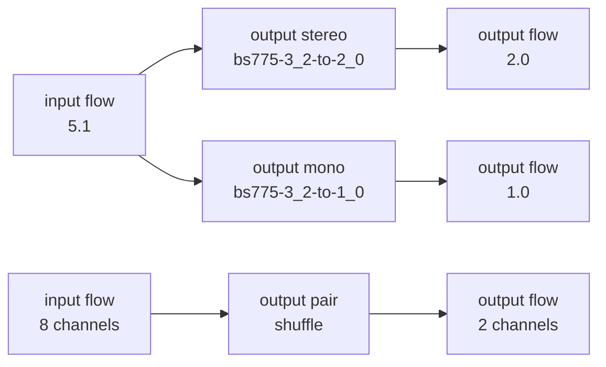

# foldz architecture

How foldz is built on samplez: what it adds, what it takes from samplez,
and where the two meet. What each feature does and how it is configured
is in [USAGE.md](USAGE.md). The engine itself, its real-time thread,
supervisor and log entries, is described in samplez's
[ARCHITECTURE.md](https://github.com/danielclasen/samplez/blob/main/docs/ARCHITECTURE.md);
foldz builds against the samplez release named in `Cargo.toml`, every
samplez crate at the same tag.

## The process

One foldz process runs one samplez engine, started standalone with
`Engine::start`. It is not replicated: an output writes one flow, and the
chart runs one replica. The engine stamps its own log entries; foldz
appends only the route, detach and output entries IS-05 activations ask
for ([NMOS](#nmos)).

Threads:

- the main thread, which blocks SIGINT and SIGTERM before any other
  thread exists, sets the process up for real time
  (`samplez::rt::setup_process`), starts everything below and then waits
  for a signal;
- the engine's RT thread and supervisor, which samplez starts;
- `foldz-service`, one current-thread tokio runtime serving the API, ops
  and NMOS listeners, the metrics exporter and the NMOS registration.

Start order: the config is read and checked and the engine's
configuration built from it, then the service (TLS and auth files), the
NMOS node and the listeners. The listeners are bound before the engine
starts, so a taken port stops the start before any flow is created. The
engine then starts and inputs without a flow are detached at once.

On SIGINT or SIGTERM the service stops, the NMOS Node is deleted from the
registry (waiting at most 5 s), and then the engine stops, which releases
the writers and so deletes the output flows.

## Presets to the engine matrix

`src/config.rs` and `src/config/check.rs` read and check the config.
Checking resolves each output to an `OutputFold`: the input it reads, the
domain it writes, and its gain matrix, which `src/presets/fold.rs` builds
from a preset table (`src/presets.rs`), a `select` or `shuffle` routing,
or an explicit matrix, with the LFE handling and `gainDb` applied. Channel
labels and layouts are `src/layout.rs`.

`Config::engine` turns that into one samplez configuration: one engine
input per input, one engine output per output, and one static gain matrix
with a row per input channel and a column per output channel. Each
output's fold sits in its input's rows and its own columns; every other
coefficient is 0. The matrix is fixed at start-up: foldz appends no gain
entries. An input without a flow is started on the nil UUID, which no
writer produces, and detached at the earliest index once the engine
runs.

## API and ops

foldz serves its listeners through `samplez-service`, which brings TLS,
auth, the `Host` check and the ops endpoints. The service takes a
replicated state; foldz's (`src/state.rs`) is a single replica named after
the host, role `standalone`, that takes no commands and stays at revision
0. The machine listener and machine token, which serve commands, are
refused.

`src/api.rs` is the `/api/v1` router foldz hands to the service: the
downmix, built once from the checked config, and the status, read from the
engine at each request. The engine sits in a shared slot that is empty
until it has started and again once it stops, which is when
`/api/v1/status` answers 503. `src/metrics.rs` samples the engine every
100 ms, beats the ops heartbeat behind `/healthz` while the RT thread's
heartbeat advances, and passes the engine, input and NMOS counters to
`/metrics`.

## NMOS

`src/nmos.rs` describes the node to `samplez-nmos`, which serves IS-04 and
IS-05 and registers the node; samplez v0.28.0 describes that crate in
[NMOS](https://github.com/danielclasen/samplez/blob/v0.28.0/docs/USAGE.md#nmos). foldz supplies:

- the node model: one Device with the function `Downmix`, a Sender per
  output and a Receiver per input, with ids derived from the seed;
- the domain ids, from each domain's `domain_def.json` or the config;
- the check of a requested flow's definition against a Receiver's caps,
  read through libmxl loaded with `samplez-mxl`;
- the application of an activation: a receiver's becomes an engine route
  or detach, a sender's enables or disables the engine output and waits up
  to 5 s for its writer; the TAI time of a scheduled one becomes a sample
  index rounded up to a block;
- the lead, the engine's buildLead plus 10 ms, by which samplez-nmos hands
  over a scheduled activation before its time;
- no store: `/active` is not persisted.

## What comes from samplez

| Crate | Used for |
|---|---|
| `samplez` | the engine, its configuration and real-time set-up |
| `samplez-dsp` | the gain matrix type and its gain limit, in the preset tables |
| `samplez-mxl` | libmxl for the NMOS flow checks and TAI-to-index conversion |
| `samplez-service` | listeners, TLS, auth, ops endpoints and metrics |
| `samplez-nmos` | the IS-04 Node API, registration and the IS-05 Connection API |
